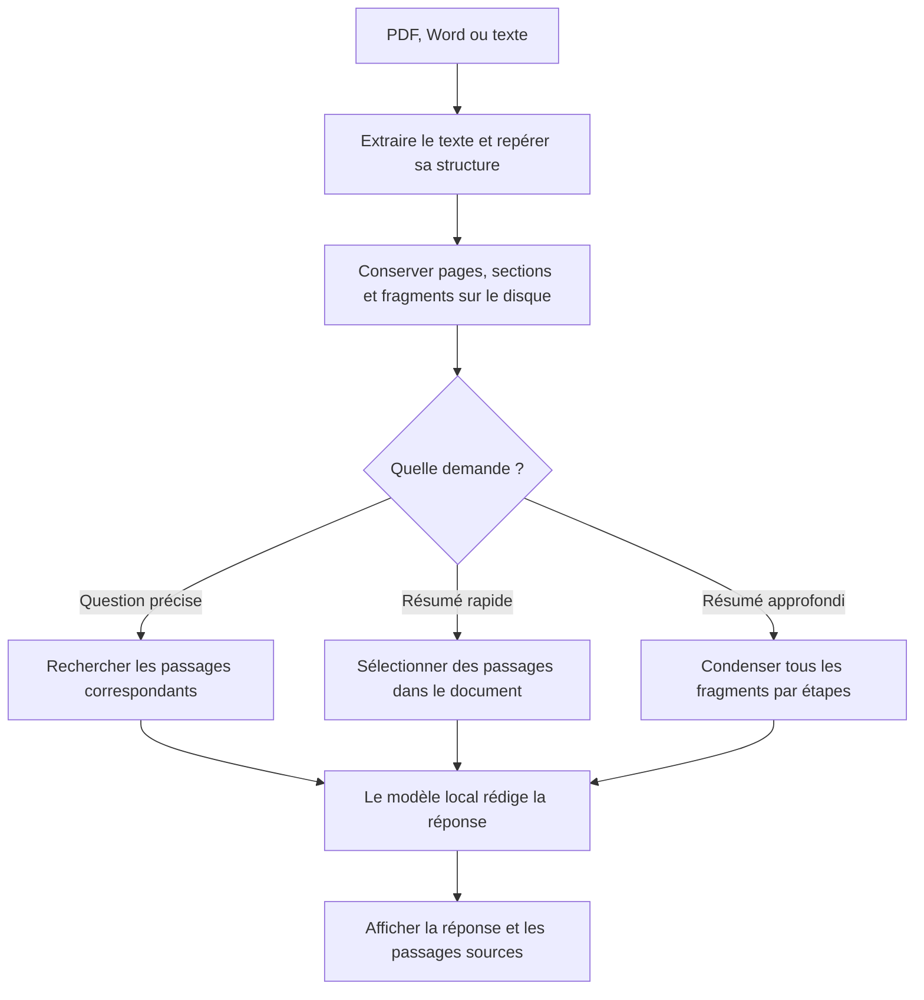

# Comprendre le fonctionnement de Clair

Clair génère les réponses via WebNN dans Edge. Les mesures CPU du 18 novembre décrivent un essai historique avec Ollama.

## Ce que fait l'application

Clair permet d'importer un PDF, un document Word ou un fichier texte, puis de poser des questions sur son contenu. Le serveur local prépare les passages. Le moteur WebNN d'Edge rédige les réponses avec le modèle sélectionné. L'interface affiche les réponses et leurs sources.

L'application choisit les passages à fournir au modèle selon la demande. Elle ne lui demande pas systématiquement de lire le document entier. C'est ce choix qui permet de réduire le travail sur CPU.

### Traduction du document

L'onglet **Traduire** suit un parcours distinct : il utilise tout le texte extrait des pages, dans l'ordre, sans sélection BM25 ni résumé intermédiaire. Le modèle reçoit des passages courts et une consigne de traduction intégrale dans la langue choisie. Le calcul respecte le même réglage **Calcul WebNN** que le chat et les résumés : automatique, GPU prioritaire, NPU prioritaire ou CPU uniquement. Chaque passage terminé est enregistré dans SQLite pour reprendre après un arrêt. Si une sortie est tronquée, le passage est divisé puis retenté ; une erreur persistante bloque l'export complet.

Le mode automatique essaie le NPU, puis le GPU, puis le CPU. Les priorités GPU et NPU essaient d'abord le périphérique demandé, puis l'autre accélérateur, puis le CPU. Un test du modèle précède son utilisation sur chaque accélérateur. Le bandeau matériel affiche le contexte retenu et les raisons des replis. Un contexte ayant exécuté le modèle ne prouve pas que toutes les opérations ont été accélérées ni quelle puce physique le navigateur a utilisée. Un résultat ou un bloc réutilisé ne déclenche aucun nouveau calcul.

Le résultat se télécharge en DOCX, avec les repères de pages ou de blocs sources et les titres reconnus. Les avertissements de l'extraction restent présents : une page scannée sans texte ne peut pas être traduite. Le fichier original et l'historique des questions sont conservés. La mise en page et les images ne sont pas reconstruites. Ce parcours vérifie que tous les blocs ont reçu une sortie terminée ; il ne valide pas automatiquement la qualité de la traduction.

## Du fichier à la réponse

**1. Importer.** L'application conserve le fichier sur le disque et calcule son empreinte : une signature qui permet de reconnaître le même fichier lors d'un nouvel import.

**2. Extraire.** Elle récupère le texte, les pages et les tableaux qu'elle sait détecter. Elle essaie aussi de repérer les titres. Un PDF scanné ou une capture d'écran peut contenir des informations invisibles à cette extraction : la reconnaissance de texte dans les images, appelée OCR, n'est pas intégrée.

**3. Découper.** Le texte est réparti en petits fragments liés aux pages et sections d'origine. Une page peut produire plusieurs fragments ; un titre isolé peut aussi en produire un. Dans le PDF testé, **111 pages donnent 299 fragments**. Ce découpage ne correspond donc pas au nombre de pages.

**4. Préparer les passages.** Selon le mode choisi, l'application recherche un fait, sélectionne des passages représentatifs ou construit des notes successives sur tous les fragments.

**5. Rédiger.** Le modèle reçoit la question, les consignes et les passages préparés. Il dispose d'une place limitée, appelée **contexte**. Cette place se compte en **tokens**, des unités de texte qui ne correspondent pas exactement à des mots. Il faut réserver de la place pour les sources, les consignes et la réponse.

**6. Revenir aux sources.** La réponse affiche des références comme `[S124]`. Chaque identifiant correspond à un fragment conservé. Une carte source permet d'ouvrir le texte original et, pour un PDF, sa page physique. Dans Word et les fichiers texte, les références correspondent à des blocs logiques, car la pagination n'est pas stable.

## Choisir le mode selon le besoin

| Votre besoin | Mode | Ce que reçoit le modèle |
| --- | --- | --- |
| « Quel est le budget annoncé pour 2027 ? » | Automatique, généralement recherche BM25 | Des passages retrouvés par les mots de la question. |
| « Fais-moi un résumé du document. » | Automatique, résumé rapide | Une sélection répartie dans le document ; tout le texte s'il tient dans le contexte. |
| Parcourir tous les fragments extraits avant la synthèse | Résumé approfondi | Des notes issues de regroupements successifs. |
| Lire un petit document en entier | Lecture directe | Tout le texte si le budget le permet ; sinon une erreur indique que ce mode ne convient pas. |
| Comparer des informations dispersées | Résumé + BM25 | La synthèse préparée, complétée par des passages du texte original. |
| « Résume le chapitre 3. » | Détection automatique d'une section | Le texte de la section détectée, condensé par étapes si nécessaire. |

Le mode automatique repose sur des mots-clés, pas sur une compréhension parfaite de l'intention. Une demande contenant « risques » ou « décisions » est notamment orientée vers le rapide. Le mode reste sélectionnable dans les paramètres. Les questions sont indépendantes : pour une relance, nommez de nouveau le sujet.

## Comment le résumé rapide gagne du temps

L'application examine le texte extrait **sans appeler le modèle**. Elle rassemble les fragments contigus pour retrouver les phrases, écarte les pages de sommaire détectées et classe les passages. Elle cherche à répartir la sélection sur les pages et les sections, tout en limitant les répétitions.

La sélection s'arrête quand le budget de contexte est atteint. Le modèle produit ensuite le résumé en **un seul appel de rédaction**. Il n'y a pas de génération intermédiaire pour chaque fragment. Si tout le texte tient dans le budget, il est fourni intégralement.

Une réserve importante, un chiffre ou un thème peut rester en dehors des passages sélectionnés. Sous la réponse, l'application affiche les sections retenues et non retenues. « Section retenue » signifie qu'un passage de cette section a été fourni au modèle, pas que toute la section est résumée.

## Ce que conserve le mode approfondi

Le mode approfondi parcourt tous les fragments extraits. Il les regroupe selon la place disponible, demande une note courte pour chaque lot, puis regroupe les notes jusqu'à obtenir une synthèse globale. Un dernier appel rédige la réponse à la question.

Le nombre de lots dépend de leur taille et du contexte : il n'est pas fixé à 135 ou à quatre. Les **135 lots** correspondent à un ancien plan pour le PDF testé ; le nouveau plan sans cache utilisait **quatre lots de lecture**, puis une synthèse globale et une réponse finale, soit six appels.

Ce mode lit davantage de matière, mais reste une succession de condensations. Il peut perdre des nuances et ne garantit pas une meilleure fidélité. Le bouton **Préparer les synthèses** prépare ce travail approfondi ; il n'est pas nécessaire pour lancer un résumé rapide ou une question factuelle.

## Pourquoi une deuxième demande peut être immédiate

Un **cache** conserve un résultat déjà calculé :

- Le même fichier peut réutiliser son extraction.
- Un lot de synthèse terminé peut être réutilisé lorsque son contenu, le modèle et les paramètres restent compatibles.
- La même question, sur le même document et avec les mêmes réglages, peut retrouver directement sa réponse terminée et ses sources.

Une réponse réutilisée n'est pas relue par le modèle. L'interface le signale. Une réponse tronquée, sans citation ou avec des références non autorisées ne devient pas une réponse en cache. Une interruption conserve les lots déjà terminés pour une reprise ultérieure.

## Ce qui a été mesuré

Essai du **18 novembre 2026**, même PDF de 111 pages, Qwen 3.5 9B Q4_K_M, calcul CPU sur le PC de développement. Les caches de calcul étaient vides et le modèle avait été préchargé. Le texte était déjà extrait : ces durées portent sur le résumé, pas sur l'import complet.

| Mode | Durée | Appels de génération |
| --- | ---: | ---: |
| Rapide | **4 min 03 s** | **1** |
| Approfondi optimisé | **18 min 21 s** | **6** |
| Même demande déjà en cache | Environ 0,30 s | 0 |

Le rapide a été **4,53 fois plus rapide dans cet essai**, avec 77,9 % de temps en moins. Il s'agit d'une mesure par mode, pas d'une vitesse garantie sur tous les documents ou postes. L'heure de traitement signalée avant optimisation n'a pas de journal natif complet permettant une comparaison contrôlée.

## Ce qu'il faut vérifier dans une réponse

Le modèle a-t-il conservé la réserve, correctement repris le chiffre et cité un passage qui justifie son affirmation ? Les sources restent consultables pour faire ces vérifications.

Un exemple observé dans le PDF est parlant : le texte indique que la conformité au RGAA n'a pas été démontrée. Le rapide a écrit que le développement respecte le RGAA ; l'approfondi a écrit qu'il n'est pas conforme. **Aucune de ces conclusions n'est justifiée par cette seule information.** Le gain de temps est mesuré ; la fidélité complète ne l'est pas.

Une sélection couvrant les quatre chapitres n'assure pas que les quatre apparaissent dans la réponse finale. Le mode approfondi parcourt tout le texte extrait, mais ne lit pas les images et ne garantit pas l'exhaustivité du résumé.

## Une explication à reprendre à l'oral

> Clair prépare le document avant de le faire résumer. Il extrait le texte, conserve les pages et le découpe en fragments. Pour une question précise, il recherche les passages utiles. Pour un résumé rapide, il choisit des passages répartis dans le document, puis demande une seule rédaction au modèle local. Le mode approfondi parcourt tous les fragments et les condense par étapes. Les résultats terminés sont gardés pour éviter de refaire le même calcul. Sur notre PDF de 111 pages, le rapide a pris quatre minutes, contre dix-huit pour l'approfondi. Les sources restent consultables, car le modèle peut encore déformer une réserve ou mal attribuer une information.

Pour les détails : [architecture](ARCHITECTURE.md). Pour les mesures et erreurs constatées : [validation](VALIDATION.md) et [rapport détaillé](RESUME_RAPIDE.md).
